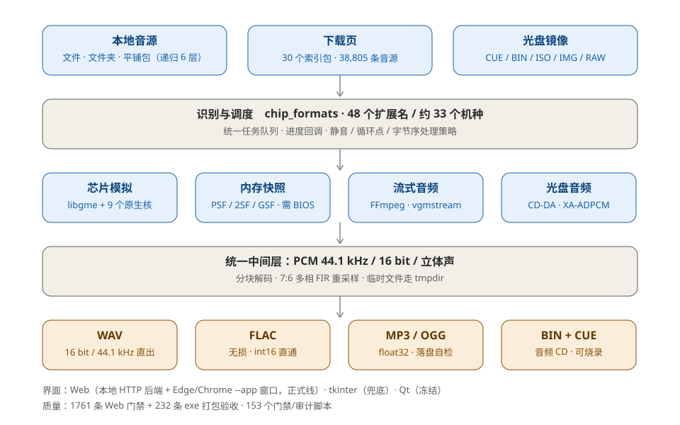

# 🎮 RetroMusic Lab · MSU1Converter

> Turn game music from 30+ retro consoles into playable audio — or a burnable CD.

<p align="center">
  <a href="README.md"></a>
  <a href="README.en.md"></a>
</p>

<p align="center">
  
  
  
  <a href="https://github.com/hualazimo7/RetroMusicLab/releases/latest"></a>
  
</p>

**RetroMusic Lab** (internal codename MSU1Converter) is a Windows desktop tool that takes
game music scattered across emulator formats — NSF, SPC, PSF, GSF, 2SF, USF, SSF, DSF, QSF,
KSS, HES, WSR, S98, VGM, disc images — decodes it into standard PCM, and writes it out as
**WAV / FLAC / MP3 / OGG**, or as a **burnable audio CD (BIN+CUE)**.

It is also a **music source downloader**: a built-in catalog of 30 systems (38,805 entries)
lets you browse by platform, batch-download, auto-extract, convert, fetch cover art, and
upload the results to NetEase Cloud Music.

<details>
<summary>📖 Table of contents</summary>

- [The problem](#-the-problem)
- [Features](#-features)
- [Supported formats](#-supported-formats)
- [UI and workflow](#️-ui-and-workflow)
- [Quick start](#-quick-start)
- [Run from source](#️-run-from-source)
- [Building](#-building)
- [Project layout](#️-project-layout)
- [Architecture](#️-architecture)
- [Quality gates](#-quality-gates)
- [Known limitations](#️-known-limitations)
- [FAQ](#-faq)
- [Contributing](#-contributing)
- [License](#-license)
- [Credits](#-credits)

</details>

---

## 🧩 The problem

Game music has no common format. The same BGM can arrive as:

| Form | Examples | Difficulty |
|---|---|---|
| 🎛️ Chip register log | `.nsf` `.spc` `.hes` `.s98` | Needs a real emulator core to make sound |
| 🧠 Memory snapshot | `.psf` `.gsf` `.2sf` `.usf` `.ssf` | CPU + sound coprocessor emulation; PSF also needs a BIOS |
| 📦 Container with sample banks | `.qsf` `.miniqsf` `.gsf` + `.gsflib` | Program and samples are split across a `_lib` chain |
| 🎬 Prerecorded stream | `.wem` `.fsb` `.adx` `.brstm` `.hca` | Vendor-specific containers FFmpeg doesn't fully support |
| 💿 CD audio tracks | `.cue` + `.bin/.iso` | CD-DA byte order, XA-ADPCM, mismatched CUE filenames |

Every format has its own trap: the sample rate isn't always 44100 (QSound runs at 24038),
loop points are measured in samples, a "silent" track may actually contain music, byte order
differs per track, and a non-ASCII path can break the decoder entirely.

This project absorbs all of that into one layer: **identify → decode → unify to
44.1 kHz / 16-bit PCM → write out**. You just add files.

## ✨ Features

- 🎼 **48 extensions across ~33 systems**, driven by `chip_formats.ALL_EXTS` — not a hand-written list.
- 🎚️ **Four output formats**: WAV (16/44.1), FLAC (lossless), MP3 (320 kbps CBR),
  OGG (chunked writes). Every lossy/lossless encoder **verifies its own output**:
  it decodes the file back and compares SNR against the source PCM, and fails loudly
  instead of handing you a file that "sounds like noise".
- 💿 **Audio CD**: produce BIN+CUE and burn it with ImgBurn — playable in any CD player.
- 🕹️ **Disc images**: extract CD-DA tracks from `.cue/.bin/.iso/.img/.raw`. When the
  red-book tracks are silent, it automatically falls back to **XA-ADPCM** inside the data
  track (common on PS1) — data-only discs still produce music.
- 🌐 **Download page**: 30 platform indices, 38,805 entries; browse, search, batch-download,
  auto-extract, auto-convert, resume on failure.
- ☁️ **NetEase Cloud upload**: QR or browser login, upload straight after conversion
  (the cloud only accepts MP3/FLAC, so the app transcodes automatically).
- 🖼️ **Cover art**: libretro-thumbnails + IGDB, multiple covers with a carousel. If the
  numbers in a title don't match, it **refuses to attach a cover** rather than risk a sequel.
- 🈶 **Chinese titles**: built-in mapping covering ~98.6%, overridable by user tables.
- 🎧 **Preview player**: play bar, previous/next, draggable progress, live spectrum.
- 🔗 **Track merging**: keeps individual tracks and also writes `<name> (merged).wav`
  with 500 ms gaps.

## 🎮 Supported formats

★ means a full emulator core is bundled — nothing extra to install.

| System | Extensions | Notes |
|---|---|---|
| NES / FC | `.nsf` `.nsfe` | No BIOS |
| SNES / SFC | `.spc` | Duration comes from ID666 tags |
| Game Boy / Color | `.gbs` | Silence detection must be off |
| Game Boy Advance | ★ `.gsf` `.minigsf` | mGBA core |
| Nintendo DS | ★ `.2sf` `.mini2sf` | DeSmuME core |
| Nintendo 64 | ★ `.usf` `.miniusf` | lazyusf2 core |
| GameCube | ★ `.psf` (Pivotal variant) `.txtp` | Detected by byte 4; no BIOS |
| Wii | `.brstm` | Prerecorded stream |
| Wii U | `.fsb` `.btsnd` | vgmstream |
| Nintendo 3DS | `.laac` | Raw AAC |
| PlayStation | ★ `.psf` `.minipsf` `.psf1` `.txtp` `.xa` | **Needs a PS1 BIOS** |
| PlayStation 2 | ★ `.psf2` `.minipsf2` `.npsf` | **Needs a PS2 BIOS** |
| PlayStation 3 | `.XVAG` `.AT3` | Prerecorded stream |
| PSP | `.hca` `.at3` | Prerecorded stream |
| PS Vita | `.at9` `.vag` `.txtp` | PSX-ADPCM family; no BIOS |
| PlayStation 4 | `.wem` `.bik` `.txtp` | Wwise / Bink |
| Saturn | ★ `.ssf` `.minissf` | SCSP emulation |
| Dreamcast | ★ `.dsf` `.minidsf` `.dvi` | AICA |
| Mega Drive / Genesis | `.vgm` `.vgz` `.gym` | Register logs |
| Master System / GG / Coleco | ★ `.sgc` `.kss` | libkss |
| PC Engine | `.hes` | Track list comes from the sibling `.m3u` |
| WonderSwan / Color | ★ `.wsr` | Track number lives in the AX register |
| 3DO | `.aif` `.aiff` `.aifc` | SDX2 / PCM; 4-bit XA reports a clear error |
| MSX / MSX2 | `.kss` | libkss |
| Atari 8-bit | `.sap` | POKEY |
| ZX Spectrum | `.ay` | YM2149 |
| PC-98 / PC-88 | `.s98` | ymfm (YM2608) |
| Capcom QSound arcade | ★ `.qsf` `.miniqsf` | CPS1 / CPS2, native 24038 Hz |
| Xbox 360 | `.xma` | Prerecorded stream |
| Xbox | `.araw` | Prerecorded stream |
| Disc images | `.cue` `.bin` `.iso` `.img` `.raw` | CD-DA + XA-ADPCM |
| Other audio | `.mp3` `.wav` `.flac` `.ape` | Disc-image branch only |
| Sample libraries | `.psflib` `.psf2lib` `.qsflib` `.usflib` `.2sflib` `.ssflib` `.dsflib` | Companion files only |

The full list and per-format notes live in the [user guide](docs/使用说明-v1.0.md)
(Chinese); the single source of truth in code is `msu1-to-cd/chip_formats.py`.

## 🖥️ UI and workflow

The UI is a **local HTTP backend plus the system Chromium in `--app` mode**: it looks like a
standalone window with no address bar or tabs, but it is not Electron. Edge is preferred,
then Chrome / Brave / Vivaldi; if none exists it falls back to the built-in tkinter UI
(older, but guaranteed to open).

### 🔄 Converting: three steps

1. **Add sources** — “Add files”, or “Add folder” (recursive, depth 6, up to 5000 sources per
   batch). A folder that is itself a package (a stack of `.spc`, a pile of `.txtp`) counts as
   one source instead of flooding the list.
2. **Pick output** — WAV / FLAC / MP3 / OGG, or “Audio CD” for BIN+CUE. You can cap track
   length, set a fade, and choose the destination.
3. **Start** — progress is reported per source and per track, cancellable at any time;
   finished work is never redone.

### 🌐 Download page

Pick a platform on the left, browse the source list in the middle (searchable, multi-select,
sizes shown), watch tasks and logs on the right. You can download, download-and-convert to
WAV / FLAC, or fetch only cover art. Packages land under your chosen root, grouped by
platform and game.

### ☁️ Cloud upload

Batch upload, skip files that already exist (md5-based), and verify at the end of the batch.
Uploading is mutually exclusive with downloading/converting so the same files are never
touched twice at once.

## 🚀 Quick start

### Use a release build (recommended)

1. Download `RetroMusicLab-v1.0-win64.zip` (~68 MB) from
   [Releases](https://github.com/hualazimo7/RetroMusicLab/releases/latest).
2. Extract into a directory **you can write to**, e.g. `D:\RetroMusic\`.
   ⚠️ Avoid `C:\Program Files\` (no write access for logs/config) and `%TEMP%`.
3. Double-click `RetroMusicLab.exe`. Cold start is 2–3 s on NVMe; on a spinning disk or
   with real-time AV scanning it can take 20–60 s with no window and no log — **wait 30 s**.
4. If it never opens, read `logs\startup.log` next to the exe; the last line tells you where
   it stopped.

> 💡 The exe is self-contained: no Python, no .bat. Decoders such as vgmstream are embedded
> in the executable, so not seeing any DLL is normal. PSF/PSF2 need your own BIOS, pointed to
> once in the UI. **No BIOS is bundled or redistributed.**

### Use the standalone exe

You can also grab just `RetroMusicLab.exe` and double-click it. vgmstream — required for
`.wem` / `.fsb` — is embedded, so **no extra DLLs are needed**.

## 🛠️ Run from source

Requires **Windows 10/11 x64** and **Python 3.14** (full system install with tkinter;
embedded/Microsoft Store builds won't work).

```bat
pip install numpy soundfile av segno py7zr pycryptodome
cd msu1-to-cd
python msu1_web.py
```

Useful flags:

```bat
python msu1_web.py --port 0      :: random port
python msu1_web.py --browser     :: use the default browser, no --app window
python msu1_web.py --console     :: keep a console and print every startup step
```

## 📦 Building

```bat
cd msu1-to-cd
python build_web_pyi.py
```

The artifact is `build/RetroMusicLab-pyi/RetroMusicLab.exe`.
⚠️ The script does **not** copy it to `dist/` — do that manually. Close any running exe
before building, otherwise PyInstaller fails during `assemble` because the file is locked.

The version number must be changed in **five places**: `dl_convert.AUDIO_WRITER_VERSION`,
`web_ui/server.APP_VERSION`, `web_ui/index.html` (`<title>` and `.brand-ver`),
`build_web_pyi.VER`, and the first line of the user guide.

## 🗂️ Project layout

```
.
├─ msu1-to-cd/                Core code
│  ├─ msu1_web.py             Web entry point (shipping line)
│  ├─ msu1_gui.py             tkinter entry point (fallback / legacy UI)
│  ├─ msu1_qt.py + qt_ui/     Qt experiment (frozen since 2026-10, not shipped)
│  ├─ msu1_to_cd.py           Conversion pipeline: identify → decode → output / CD
│  ├─ chip_formats.py         Format and system registry (pure parsing, no heavy deps)
│  ├─ chip_decode.py          Chip music decoding (libgme)
│  ├─ stream_audio.py         Prerecorded stream decoding (FFmpeg / vgmstream)
│  ├─ cd_audio.py             Disc audio extraction (PyAV / CD-DA / XA)
│  ├─ flac_out.py             WAV / FLAC / MP3 / OGG encoding + output verification
│  ├─ cover_art.py            Cover fetching and matching
│  ├─ netease_cloud.py        NetEase Cloud upload
│  ├─ web_ui/                 HTTP backend + frontend (app.js / download.js / css)
│  ├─ vendor/                 153 gate / audit / diagnostic scripts
│  ├─ tools/                  C sources and build scripts for 10 native decoders
│  └─ index/                  30 source index packs (38,805 entries)
├─ docs/                      Handover manual, dev notes, user guide, diagrams
├─ design-system/             Design tokens and rules (palette / contrast gates)
├─ THIRD-PARTY-NOTICES.md     Third-party licenses
└─ LICENSE                    MIT
```

## 🏗️ Architecture



Three inputs (local files, download page, disc images) are identified by `chip_formats`,
decoded along one of four paths, and converge on a single PCM stage before splitting into
four outputs. Adding a new system only touches “identification + one decode path” — the
output side never changes.

Module contracts and per-format war stories live in
[docs/项目交接手册-20261027.md](docs/项目交接手册-20261027.md) (Chinese): MP3/OGG encoding,
XA-ADPCM layout, CD-DA byte order, and more.

The per-version rework log is [docs/开发笔记-踩坑全集.md](docs/开发笔记-踩坑全集.md)
(Chinese): 75 numbered ⚠️ notes, each with symptom, root cause, fix, and the gate that
locks it in.

## ✅ Quality gates

There is no CI; instead there is a reproducible set of local gates:

| Gate | Covers | Size |
|---|---|---|
| `vendor/test_web_ui.py` | Web API, frontend wiring, per-version regressions | **1761 assertions** |
| `vendor/check_web_exe.py` | The packaged exe (assets, worker flags) | **232 assertions** |
| `vendor/test_*.py` | Disc / chip / PSF / WSR / progress / temp-dir suites | 30+ scripts |
| `design-system/check_design_system.py` | Tokens ↔ code consistency, contrast | 21 checks |

```bat
python vendor/test_web_ui.py
python vendor/check_web_exe.py --exe ..\deliverables\v1.0-web\RetroMusicLab.exe
```

Lessons baked into the process:

- 🧪 **Prove your measurement first**: a memory probe that always returns 0 is more dangerous
  than a failing test.
- 🎯 **Compare like with like**: averaging every track and comparing it to the longest track
  guarantees a false failure.
- 🪞 **A self-consistent gate isn't a correct format**: if the synthesizer and the decoder
  share the same wrong layout, sample-by-sample comparison still passes.
- ⏱️ **Short samples hide long-audio bugs**: writing a long OGG in one call overflows the
  stack and kills the process, while a 4-second sample passes every time.

## ⚠️ Known limitations

- 💾 **PSF / PSF2 need a BIOS**: no Sony BIOS is included or redistributed; point the app at
  your own file.
- 🖱️ **Browser drag-and-drop cannot get paths**: Chromium does not expose `File.path`.
  Dropping a folder opens a native picker so you can select it manually; using
  “Add folder” is faster.
- 🖼️ **No cover is better than a wrong cover**: when the catalog only has a sequel, the
  number check rejects it (since v1.0).
- 💿 **Disc images are audio-only**: CD-DA and XA-ADPCM inside data tracks; no video or
  data extraction.
- 🗓️ **The index is a static snapshot**: `index/*.json.gz` was built on 2026-10-18; refresh it
  with `vendor/build_index.py` and repackage.
- 🪟 **Windows only**: relies on Edge/Chromium, `SHFileOperationW`, `DwmSetWindowAttribute`.
  An Android port was evaluated and rejected (see `docs/安卓移植可行性分析.md`).
- 🧊 **The Qt branch is frozen**: `msu1_qt.py` remains as a technical proof of concept and is
  not shipped.

## ❓ FAQ

**Double-click does nothing?**
Check `logs\startup.log`. If it doesn't exist, look for a `RetroMusicLab` process: if
present, it is still unpacking or being scanned by AV; if absent, it was blocked — add the
exe to your AV allowlist.

**Everything converts to silence?**
For PSF-family files check the BIOS path first. For disc images, check whether it is a
data-only disc (XA fallback runs automatically, the log says so). For chip formats, check
whether tracks were skipped as “silent” (NSF/GBS require silence detection to be off).

**MP3 sounds noisy?**
Builds before v5.9.18 had an encoder bug (int16 passed straight to libsndfile). Upgrade and
re-convert. Current builds verify SNR after writing and fail loudly if it is too low.

**Where is the output?**
The output directory chosen in the UI; download-page packages live under your save root,
grouped by platform and game.

## 🤝 Contributing

- 🐛 Bugs and format issues: open an [issue](https://github.com/hualazimo7/RetroMusicLab/issues)
  with the format name, file size, and the relevant part of `logs/startup.log`
  (**do not attach ROMs**).
- ➕ New systems: register it in `chip_formats.py`, add a decode path, add gates, and update
  the format table here.
- ✅ Before submitting, run `vendor/test_web_ui.py` and make sure no BIOS, ROM, or audio
  output is committed.

## 📄 License

Project code is **MIT** — see [LICENSE](LICENSE).

The 10 bundled decoders, runtime libraries, and cover data keep their original licenses
(GPL-2.0 / GPL-3.0 / LGPL-2.1+ / MPL-2.0 / ISC / BSD / MIT). The full list, source locations,
and compliance notes are in [THIRD-PARTY-NOTICES.md](THIRD-PARTY-NOTICES.md).

**This repository contains no** game ROMs, source packages, PS1/PS2 BIOS files, or
commercial game data.

## 🙏 Credits

[Game Music Emu](https://github.com/libgme/game-music-emu) ·
[vgmstream](https://github.com/vgmstream/vgmstream) ·
[mGBA](https://mgba.io/) ·
[DeSmuME](https://desmume.org/) ·
lazyusf2 ·
[libkss](https://github.com/digital-sound-antiques/libkss) ·
[ymfm](https://github.com/aaronsgiles/ymfm) ·
[beetle-wswan-libretro](https://github.com/libretro/beetle-wswan-libretro) ·
[psflib](https://github.com/kode54/psflib) ·
[joshw.info](https://joshw.info/) ·
[libretro-thumbnails](https://thumbnails.libretro.com/)
