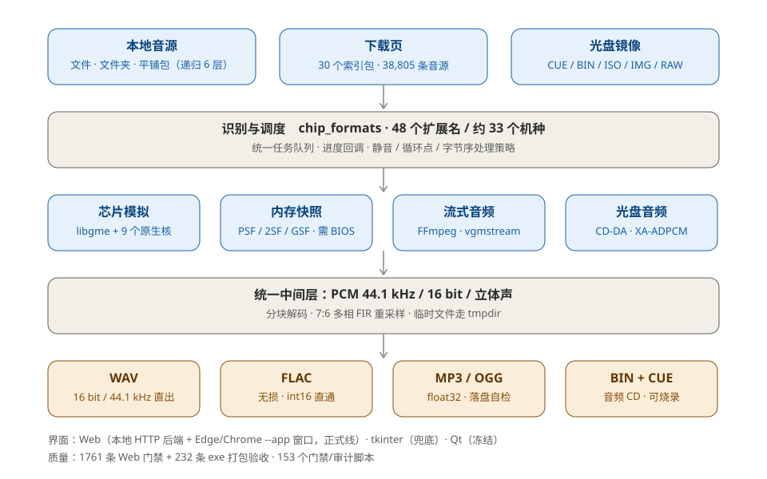

# 🎮 RetroMusic Lab · MSU1Converter

> 把 30 多个机种的游戏音乐，统一转成能听的音频、能烧的 CD。

<p align="center">
  <a href="README.md"></a>
  <a href="README.en.md"></a>
</p>

<p align="center">
  
  
  
  <a href="https://github.com/hualazimo7/MSU1Converter/releases/latest"></a>
  
</p>

**RetroMusic Lab**（内部代号 MSU1Converter）是一个 Windows 桌面工具：把散落在各种模拟器
格式里的游戏音乐——NSF、SPC、PSF、GSF、2SF、USF、SSF、DSF、QSF、KSS、HES、WSR、S98、
VGM、光盘镜像——统一解码成标准 PCM，再输出成 **WAV / FLAC / MP3 / OGG**，或者直接做成
可烧录的**音频 CD（BIN+CUE）**。

它同时是一个**音源下载器**：内置 30 个机种的索引（38,805 条），可以按机种浏览、批量下载、
自动解压、转换、配封面，并把成品传进网易云音乐云盘。

<sub>RetroMusic Lab is a Windows desktop tool that converts chip music from 30+ retro
console formats into WAV / FLAC / MP3 / OGG or a burnable audio CD, with a built-in
catalog of 38,805 source packages and optional NetEase Cloud upload.</sub>

<details>
<summary>📖 目录</summary>

- [它解决什么问题](#-它解决什么问题)
- [核心能力](#-核心能力)
- [支持的格式](#-支持的格式)
- [界面与工作流](#-界面与工作流)
- [快速开始](#-快速开始)
- [从源码运行](#-从源码运行)
- [打包](#-打包)
- [项目结构](#-项目结构)
- [架构](#-架构)
- [质量与门禁](#-质量与门禁)
- [已知限制](#-已知限制)
- [常见问题](#-常见问题)
- [参与与反馈](#-参与与反馈)
- [许可](#-许可)
- [致谢](#-致谢)

</details>

---

## 🧩 它解决什么问题

游戏音乐没有统一格式。同样是一首 BGM，可能长这样：

| 形态 | 例子 | 难点 |
|---|---|---|
| 🎛️ 芯片寄存器日志 | `.nsf` `.spc` `.hes` `.s98` | 要真跑模拟器才能出声 |
| 🧠 内存快照 | `.psf` `.gsf` `.2sf` `.usf` `.ssf` | 要连 CPU + 声音协处理器一起模拟，PSF 还要 BIOS |
| 📦 带采样库的容器 | `.qsf` `.miniqsf` `.gsf` + `.gsflib` | 采样与程序分离，要按 `_lib` 链拼装 |
| 🎬 预录流 | `.wem` `.fsb` `.adx` `.brstm` `.hca` | 各家私有容器，FFmpeg 认不全 |
| 💿 光盘音轨 | `.cue` + `.bin/.iso` | CD-DA 字节序、XA-ADPCM、CUE 文件名对不上 |

每个格式都有自己的坑：采样率不一定是 44100（QSound 是 24038）、循环点单位是采样数、
静音段可能是音乐、字节序每条轨都不一样、路径里有中文就可能打不开。

这个项目把这些差异**收在一层里**：统一识别 → 统一解码 → 统一 44.1 kHz / 16 bit PCM →
统一输出。你只需要把文件拖进来。

## ✨ 核心能力

- 🎼 **48 个扩展名 / 约 33 个机种**，以 `chip_formats.ALL_EXTS` 为准，不是手写清单。
- 🎚️ **四种输出**：WAV（16/44.1）、FLAC（无损）、MP3（320 kbps CBR）、OGG（分块写入）。
  三种有损/无损编码都带**落盘自检**：解回来和源 PCM 比 SNR，不达标直接报错，
  不给你一个「听起来像噪音」的文件。
- 💿 **音频 CD**：直接产出 BIN+CUE，用 ImgBurn 之类烧到 CD-R，普通 CD 机可播。
- 🕹️ **光盘镜像**：从 `.cue/.bin/.iso/.img/.raw` 里抽 CD-DA 音轨；整轨静音时自动改抽
  数据轨里的 **XA-ADPCM**（PS1 常见），纯数据盘也能出音乐。
- 🌐 **下载页**：30 个机种索引、38,805 条音源，支持按机种浏览、搜索、批量下载、
  自动解压、自动转换、断点重试。
- ☁️ **网易云云盘**：扫码或浏览器登录，转完直接上传（云盘只收 MP3/FLAC，程序自动转）。
- 🖼️ **封面**：libretro-thumbnails + IGDB 双源，多封面轮播；名字里的编号对不上就**不贴**，
  宁可没封面也不贴成续作。
- 🈶 **中文标题**：内置约 98.6% 覆盖率的译名表，可被用户自己的映射覆盖。
- 🎧 **试听与频谱**：内置播放条、上一曲/下一曲、可拖进度、实时频谱。
- 🔗 **多轨合并**：分轨全留，另出一份 `<源名>（合并）.wav`，曲间 500 ms。

## 🎮 支持的格式

带 ★ 的是自带完整模拟器核，不需要额外安装任何东西。

| 机种 | 扩展名 | 备注 |
|---|---|---|
| NES / FC | `.nsf` `.nsfe` | 免 BIOS |
| SNES / SFC | `.spc` | 必须按 ID666 标签取时长 |
| Game Boy / Color | `.gbs` | 静音判定要关掉 |
| Game Boy Advance | ★ `.gsf` `.minigsf` | mGBA 核 |
| Nintendo DS | ★ `.2sf` `.mini2sf` | DeSmuME 核 |
| Nintendo 64 | ★ `.usf` `.miniusf` | lazyusf2 核 |
| GameCube | ★ `.psf`（Pivotal 变体） `.txtp` | 看第 4 字节自动分辨，不要 BIOS |
| Wii | `.brstm` | 预录流 |
| Wii U | `.fsb` `.btsnd` | vgmstream |
| Nintendo 3DS | `.laac` | 裸 AAC |
| PlayStation | ★ `.psf` `.minipsf` `.psf1` `.txtp` `.xa` | **需要 PS1 BIOS** |
| PlayStation 2 | ★ `.psf2` `.minipsf2` `.npsf` | **需要 PS2 BIOS** |
| PlayStation 3 | `.XVAG` `.AT3` | 预录流 |
| PSP | `.hca` `.at3` | 预录流 |
| PS Vita | `.at9` `.vag` `.txtp` | PSX-ADPCM 家族，不要 BIOS |
| PlayStation 4 | `.wem` `.bik` `.txtp` | Wwise / Bink |
| Saturn | ★ `.ssf` `.minissf` | 需要 SCSP 模拟 |
| Dreamcast | ★ `.dsf` `.minidsf` `.dvi` | AICA |
| Mega Drive / Genesis | `.vgm` `.vgz` `.gym` | 寄存器日志 |
| Master System / GG / Coleco | ★ `.sgc` `.kss` | libkss |
| PC Engine | `.hes` | 曲目表看同目录 `.m3u` |
| WonderSwan / Color | ★ `.wsr` | 曲号在 AX 寄存器里 |
| 3DO | `.aif` `.aiff` `.aifc` | SDX2 / PCM；4bit XA 会明确报错 |
| MSX / MSX2 | `.kss` | libkss |
| Atari 8-bit | `.sap` | POKEY |
| ZX Spectrum | `.ay` | YM2149 |
| PC-98 / PC-88 | `.s98` | ymfm（YM2608） |
| Capcom QSound 街机 | ★ `.qsf` `.miniqsf` | CPS1 / CPS2，原生 24038 Hz |
| Xbox 360 | `.xma` | 预录流 |
| Xbox | `.araw` | 预录流 |
| 光盘镜像 | `.cue` `.bin` `.iso` `.img` `.raw` | CD-DA + XA-ADPCM |
| 其它音频 | `.mp3` `.wav` `.flac` `.ape` | 仅光盘镜像分支 |
| 采样库 | `.psflib` `.psf2lib` `.qsflib` `.usflib` `.2sflib` `.ssflib` `.dsflib` | 只配合主文件 |

完整清单与逐格式说明见 [使用说明](docs/使用说明-v6.0.12.md)，代码里的唯一真源是
`msu1-to-cd/chip_formats.py`。

## 🖥️ 界面与工作流

界面是「**本地 HTTP 后端 + 系统 Chromium 的 `--app` 窗口**」：看起来是一个独立窗口，
没有地址栏和标签页，但不是 Electron。优先 Edge，其次 Chrome / Brave / Vivaldi，
都没有就退回内置的 tkinter 界面（老一点，但保证能开）。

### 🔄 转换：三步

1. **加音源** —— 点「添加音源」选文件，或「添加文件夹」选目录（含子目录，递归 6 层，
   单次上限 5000 个）。选中的文件夹如果本身就是一个包（一叠 `.spc`、一堆 `.txtp`），
   会整体算一个音源，不会刷屏。
2. **选输出** —— WAV / FLAC / MP3 / OGG 四选一，或选「音频 CD」出 BIN+CUE。
   可以设单曲最长秒数、淡出、目标目录。
3. **开始** —— 进度按音源和曲目两级显示，可随时取消；已完成的不会重复转。

### 🌐 下载页

左栏选机种，中间是音源列表（可搜索、可多选、可看大小），右栏是任务与日志。
选中后可以「下载」「下载并转 WAV」「下载并转 FLAC」，也可以只「下载封面」。
下载完的包会落在你指定的根目录，按机种/游戏分文件夹。

### ☁️ 云盘

「上传云盘」支持整批上传、跳过已存在的文件（按 md5 判断）、批末校验。
上传与下载/转换互斥，避免同一批文件被两边同时动。

## 🚀 快速开始

### 用发布包（推荐）

1. 到 [Releases](https://github.com/hualazimo7/MSU1Converter/releases/latest) 下载
   `MSU1Converter-v6.0.12-web-win64.zip`（约 68 MB）。
2. 解压到一个**你有写权限**的目录，例如 `D:\RetroMusic\`。
   ⚠️ 不要放 `C:\Program Files\`（写不了日志和配置），也不要放 `%TEMP%`。
3. 双击 `MSU1Converter-web.exe`。冷启动 2~3 秒（NVMe）；机械盘或开着实时扫描的杀软
   可能要 20~60 秒，这期间没有窗口、没有日志，**先等 30 秒**。
4. 起不来就看 exe 旁边的 `logs\startup.log`，最后一行就是卡在哪一步。

> 💡 单个 exe 即可运行，不需要装 Python、不需要 bat。vgmstream 等解码器已内嵌在 exe 里，
> 目录里看不到 DLL 是正常的。PSF/PSF2 需要你自己的 BIOS，在界面里指定一次即可
> （程序只记路径，**不随包分发 BIOS**）。

### 用单个 exe

也可以只下 `MSU1Converter-web.exe`，双击即用；但 `.wem` / `.fsb` 等格式依赖的
vgmstream 也已内嵌，**不需要再找 DLL**。

## 🛠️ 从源码运行

要求 **Windows 10/11 x64** + **Python 3.14**（系统安装版，带 tkinter；嵌入式/商店版不行）。

```bat
pip install numpy soundfile av segno py7zr pycryptodome
cd msu1-to-cd
python msu1_web.py
```

常用参数：

```bat
python msu1_web.py --port 0      :: 随机端口
python msu1_web.py --browser     :: 用默认浏览器，不强制 --app
python msu1_web.py --console     :: 开控制台，逐步打印启动过程
```

## 📦 打包

```bat
cd msu1-to-cd
python build_web_pyi.py
```

产物在 `build/MSU1Converter-web-pyi/MSU1Converter-web.exe`。
⚠️ 脚本**不会**自动复制到 `dist/`，要手动 copy；打包前必须关掉正在运行的旧 exe，
否则 PyInstaller 在 assemble 阶段会因文件占用直接失败。

改版本号要**五处同改**：`dl_convert.AUDIO_WRITER_VERSION`、`web_ui/server.APP_VERSION`、
`web_ui/index.html`（`<title>` 与 `.brand-ver`）、`build_web_pyi.VER`、使用说明首行。

## 🗂️ 项目结构

```
.
├─ msu1-to-cd/                核心代码
│  ├─ msu1_web.py             Web 版入口（正式线）
│  ├─ msu1_gui.py             tkinter 版入口（兜底 / 旧界面）
│  ├─ msu1_qt.py + qt_ui/     Qt 试验版（2026-10 起冻结，不发布）
│  ├─ msu1_to_cd.py           转换主干：识别 → 解码 → 输出 / 音频 CD
│  ├─ chip_formats.py         格式与机种注册表（纯解析层，零重依赖）
│  ├─ chip_decode.py          芯片音源解码（libgme）
│  ├─ stream_audio.py         预录流解码（FFmpeg / vgmstream）
│  ├─ cd_audio.py             光盘音轨抽取（PyAV / CD-DA / XA）
│  ├─ flac_out.py             WAV / FLAC / MP3 / OGG 编码 + 落盘自检
│  ├─ cover_art.py            封面抓取与匹配
│  ├─ netease_cloud.py        网易云云盘上传
│  ├─ web_ui/                 HTTP 后端 + 前端（app.js / download.js / css）
│  ├─ vendor/                 153 个门禁 / 审计 / 诊断脚本
│  ├─ tools/                  10 个原生解码器的 C 源码与构建脚本
│  └─ index/                  30 个音源索引包（38,805 条）
├─ docs/                      交接手册、开发笔记、使用说明、架构图
├─ design-system/             设计令牌与规范（配色 / 对比度门禁）
├─ THIRD-PARTY-NOTICES.md     第三方组件许可
└─ LICENSE                    MIT
```

## 🏗️ 架构



三条输入（本地 / 下载页 / 光盘镜像）在 `chip_formats` 统一识别后，分四条解码路径落到
同一个 PCM 中间层，再分叉到四种输出。这样新增一个机种只需要动「识别 + 一条解码」，
输出侧完全不用改。

更细的模块契约、每个格式的实际踩坑记录，见
[docs/项目交接手册-20261027.md](docs/项目交接手册-20261027.md)（含 MP3/OGG 编码、
XA-ADPCM 布局、CD-DA 字节序等专题）。

逐版本的返工记录在 [docs/开发笔记-踩坑全集.md](docs/开发笔记-踩坑全集.md)：
75 篇 ⚠️ 编号笔记，每篇写清现象、根因、修法和对应的门禁。

## ✅ 质量与门禁

这个项目没有 CI，靠的是一套可重复执行的本地门禁：

| 门禁 | 覆盖 | 规模 |
|---|---|---|
| `vendor/test_web_ui.py` | Web 后端 API、前端接线、各版本回归 | **1761 条断言** |
| `vendor/check_web_exe.py` | 打包后的 exe（含前端资源、worker 参数） | **232 条断言** |
| `vendor/test_*.py` | 光盘 / 芯片 / PSF / WSR / 进度 / 临时目录等专项 | 30+ 个 |
| `design-system/check_design_system.py` | 设计令牌 ↔ 代码一致性、对比度 | 21 项 |

```bat
python vendor/test_web_ui.py
python vendor/check_web_exe.py --exe ..\deliverables\v6.0.12-web\MSU1Converter-web.exe
```

几条被写进流程的经验：

- 🧪 **度量函数先证明有效**：一个恒返回 0 的内存统计，比测试失败更危险。
- 🎯 **断言两侧必须同源**：拿「每轨平均」去比「最长一轨」，必然假红。
- 🪞 **门禁自洽 ≠ 格式正确**：合成器和解码器按同一个错误布局写，逐采样比对也能全过。
- ⏱️ **短样本测不出长音频的坑**：OGG 一次性写长曲会栈溢出杀进程，4 秒样本全过。

## ⚠️ 已知限制

- 💾 **PSF / PSF2 需要 BIOS**：程序不含、也不分发 Sony BIOS，需用户指向自己的文件。
- 🖱️ **浏览器拖放拿不到路径**：Chromium 不提供 `File.path`。拖入后会自动弹原生选择框，
  让你选同一个文件夹；想一步到位就直接点「添加文件夹」。
- 🖼️ **封面宁缺勿错**：库里有续作时，名字编号对不上就不贴（v6.0.12 起的策略）。
- 💿 **光盘镜像只处理音频轨**：CD-DA 与数据轨里的 XA-ADPCM；不做视频/数据提取。
- 🗓️ **索引是静态快照**：`index/*.json.gz` 构建于 2026-10-18，重新抓取需跑
  `vendor/build_index.py` 后重新打包。
- 🪟 **仅 Windows**：依赖 Edge/Chromium、`SHFileOperationW`、`DwmSetWindowAttribute` 等。
  安卓移植评估过，结论是不可行（见 `docs/安卓移植可行性分析.md`）。
- 🧊 **Qt 分支已冻结**：`msu1_qt.py` 保留作为技术验证，不随发布包提供。

## ❓ 常见问题

**双击没反应？**
看 exe 旁的 `logs\startup.log`。没有这个文件，就看任务管理器里有没有
`MSU1Converter-web` 进程：有，是在解包/被杀软扫描；没有，多半被系统策略拦了，
把 exe 加进杀软白名单。

**转出来全是静音？**
PSF 家族先检查 BIOS 路径；光盘镜像看是不是纯数据盘（程序会自动尝试 XA，但日志里会写明）；
芯片格式看是不是被判成「静音曲目」跳过了（NSF/GBS 等必须关掉静音检测）。

**MP3 有杂音？**
v5.9.18 之前的老版本有编码 bug（int16 直传 libsndfile），升级到当前版本重转即可。
现在的 MP3 落盘会自检 SNR，不达标直接报错。

**输出在哪？**
界面上选的输出目录；下载页的包在「保存根目录」下按机种/游戏分文件夹。

## 🤝 参与与反馈

- 🐛 Bug / 格式兼容问题：开 [Issue](https://github.com/hualazimo7/MSU1Converter/issues)，
  附上格式名、文件大小、`logs/startup.log` 相关片段（**不要附 ROM 本体**）。
- ➕ 新增机种：在 `chip_formats.py` 注册，补一条解码路径，加门禁，再更新本 README 的格式表。
- ✅ 提交前请至少跑 `vendor/test_web_ui.py`，并确保没有把 BIOS、ROM、音频成品提交进仓库。

## 📄 许可

本项目代码采用 **MIT**，见 [LICENSE](LICENSE)。

随包分发的 10 个解码器、运行时库与封面数据遵循各自原始许可（GPL-2.0 / GPL-3.0 /
LGPL-2.1+ / MPL-2.0 / ISC / BSD / MIT），完整清单、源码位置与合规说明见
[THIRD-PARTY-NOTICES.md](THIRD-PARTY-NOTICES.md)。

**本仓库不包含**任何游戏 ROM、音源包本体、PS1/PS2 BIOS 或商业游戏数据。

## 🙏 致谢

[Game Music Emu](https://github.com/libgme/game-music-emu) ·
[vgmstream](https://github.com/vgmstream/vgmstream) ·
[mGBA](https://mgba.io/) ·
[DeSmuME](https://desmume.org/) ·
lazyusf2 ·
[libkss](https://github.com/digital-sound-antiques/libkss) ·
[ymfm](https://github.com/aaronsgiles/ymfm) ·
[beetle-wswan-libretro](https://github.com/libretro/beetle-wswan-libretro) ·
[psflib](https://github.com/kode54/psflib) ·
[joshw.info](https://joshw.info/) ·
[libretro-thumbnails](https://thumbnails.libretro.com/)
