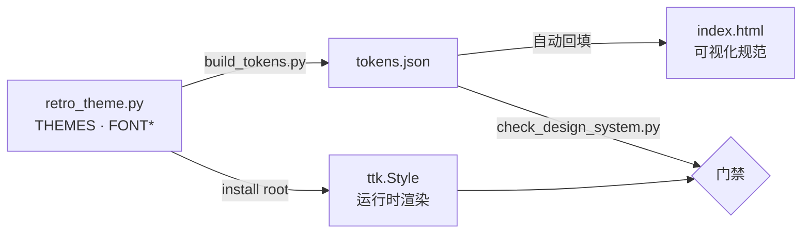

# RetroMusic Lab 设计规范 v1.0

> 适用产品：**MSU1Converter（RetroMusic Lab）** — Windows 桌面工具，把复古游戏机音源
> （SPC / NSF / GBS / HES / KSS / SAP / GYM / AY / VGM…）转成 MSU1 CD 音轨或 WAV。
> 技术底座：纯 **tkinter / ttk**（clam），无第三方 GUI 依赖；6 套主机配色可运行时切换。
>
> 本规范是**唯一权威**。代码里的真源是 `msu1-to-cd/retro_theme.py`，
> 本目录的 `tokens.json` 由它生成，`index.html` 是可视化对照，`check_design_system.py` 是门禁。
> 三者不一致时，以**代码**为准，然后重跑生成脚本 —— 绝不允许反过来改代码去迁就文档。

---

## 0. 这套规范怎么用

| 你的角色 / 场景 | 先看 | 然后 |
|---|---|---|
| 加一个新按钮 / 一个分区 | §6 组件规范 | 只用 `<Name>.TButton` / `Card.TLabelframe`，不要自己写颜色 |
| 调一套配色 | §3 色彩 + §10 主题扩展 | 改 `THEMES` → `python retro_theme.py --all` → `build_tokens.py` |
| 评审一个界面 | §2 令牌 + §13 Do/Don't | 跑 §12 三道门禁 |
| 前端 / 文档 / 官网要做同款视觉 | `tokens.json` | 用语义层（`surface.*` / `text.*`），不要用颜色名 |

**三条红线**（违反任何一条，这个皮肤就散了）：

1. **颜色只从 `PALETTE` 取**，界面代码里不出现 `#RRGGBB` 字面量（像素画/横幅除外）。
2. **圆角永远是 0**，描边永远是 1px `line`。这是"机身贴纸"而不是"网页卡片"。
3. **改任何配色必须跑 `retro_theme.py --all`**，25 组对比度全过才算改完。

---

## 1. 设计原则

### 1.1 界面是"机器面板"，不是网页
用户在用一台 8-bit 时代的转换机：米黄机身、丝印字、硬边按钮、一颗红色电源灯。
所以：无圆角、无投影、无渐变、无毛玻璃。分层靠**三级底色的明度差 + 1px 描边**，
不靠阴影。任何"卡片悬浮感"都是错的。

### 1.2 先可读，再复古
复古是**皮肤**，不是借口。所有文字必须过 WCAG AA；霓虹青只做强调，
绝不做大段正文；像素画只用在小面积标识（横幅、勾选框 12×12）。

### 1.3 六套皮肤，一套骨骼
换主题只换**颜色**。字号、间距、控件尺寸、布局在所有主题下必须一致 ——
否则切主题会让窗口跳动，用户会以为程序坏了。

### 1.4 状态必须三重可辨
「成功 / 警告 / 失败」不能只靠颜色：颜色 + 文案前缀（`✔ / ! / ✘`）+ 位置/图标。
色弱用户与灰度截图都要能读。

### 1.5 主界面不打断用户
转换、下载、上传都是长任务：进度可停、日志可追、关闭有确认。
禁止模态弹窗打断批量流程（除"覆盖确认""换号"这类不可逆决策）。

---

## 2. 令牌体系（三层）

```
第 1 层 原始值   retro_theme.THEMES[key]["palette"]   14 个色位 × 6 套
                 ↓ 语义映射（冻结）
第 2 层 语义位   surface.* / text.* / accent.* / status.* / selection.*
                 ↓ 组件绑定（ttk style 名）
第 3 层 组件     TButton / Accent.TButton / Treeview / TLabelframe …
```



**语义映射表**（左列是设计侧唯一允许的说法）：

| 语义令牌 | 代码键 | 用途 |
|---|---|---|
| `surface.base` | `bg` | 窗口底 |
| `surface.panel` | `panel` | 分区底板（Labelframe / 日志框） |
| `surface.raised` | `card` | 输入框、表格、文本域底（最亮） |
| `surface.sunken` | `card2` | 次级卡片、按钮底、hover 槽 |
| `border.hairline` | `line` | 所有 1px 描边、分隔线、滚动条滑块 |
| `text.primary` | `text` | 正文、选中行文字 |
| `text.secondary` | `muted` | 辅助说明、表头、副标题 |
| `text.tertiary` | `dim` | 不可用 / 弱化（仅 3.0:1，禁用于正文） |
| `accent.primary` | `cyan` | 主强调：选中、进度、主按钮、分区标题 |
| `accent.secondary` | `magenta` | 次强调：装饰、频谱另一端 |
| `accent.numeric` | `amber` | 数值 / 等宽文本（时长、大小、路径） |
| `status.success` | `green` | 成功 |
| `status.danger` | `red` | 失败 |
| `selection.bg` | `sel` | 列表选中底 |
| `selection.fg` | `text` | 选中底上的字（**不是**强调色） |
| `on.accent` | `onAccent` | 强调底上的字 |

> ⚠ **键名是语义位，不是颜色名。** 红白机主题里 `cyan` 的实际值是砖红 `#b33428`，
> `magenta` 是深青 `#1c6b78` —— 完全反直觉，但这两个键被 GUI 里 26 处引用，
> 改名会全线崩。**看键名请当它是"主强调 / 次强调"，不是颜色。**

---

## 3. 色彩系统

### 3.1 六套主题（14 色位 + onAccent）

| 主题 | label | 底 bg | 板 panel | 卡 card | 主强调 | 次强调 | 数值 |
|---|---|---|---|---|---|---|---|
| `famicom` ★默认 | 红白机 Famicom | `#efe6d3` | `#faf5e9` | `#fffdf7` | `#b33428` 砖红 | `#1c6b78` | `#9d6412` |
| `nes` | 美版 NES | `#d6d4cf` | `#e7e5e0` | `#f6f5f2` | `#4a2a7a` 紫 | `#a8291f` | `#7a5a10` |
| `gameboy` | Game Boy（DMG） | `#c3cc9c` | `#d3dcb4` | `#e5eacd` | `#2a4c19` 墨绿 | `#6b4710` | `#6b4710` |
| `pce` | PC Engine | `#e8e3da` | `#f5f1e9` | `#fffdf8` | `#a83712` 橙红 | `#1f5f7a` | `#8a5a10` |
| `megadrive` | Mega Drive | `#dbdad5` | `#ebe9e3` | `#f8f7f3` | `#1c3f8f` 蓝 | `#8a5c0c` | `#8a5c0c` |
| `sfc` | 超任 Super Famicom | `#d8d4cb` | `#eae6dd` | `#faf8f3` | `#5a3d8c` 紫 | `#2c6b5e` | `#7a570c` |

完整 14 位色值见 `tokens.json → color.themes.<key>.palette`，可视化见 `index.html`。

**主题设计约束**（新增主题必须满足）：

- 底色明度必须落在 **浅色区间**（`L* > 80`）：产品只有浅色皮肤，深色机身不做。
- `bg / panel / card / card2` 四级明度必须**单调递增**，相邻两级至少差 3 个 `L*`，
  否则按钮会"消失"（v4.16 真实踩过：`card` 与 `panel` 几乎同色）。
- 主强调必须能压在 `bg/panel/card` 三种底上（4.5:1），且 `onAccent` 压在它上面也 4.5:1。

### 3.2 用色铁律

| 规则 | 原因 |
|---|---|
| **选中行用墨字，不用强调色** | 浅色底上整行转红会被读成"失败"（v4.16 第一版踩过） |
| `red` 只给失败，不做装饰 | 唯一例外：红白机主题的 `cyan` 本身就是砖红 —— 那是"电源灯"，不参与语义 |
| `amber` 只给数值/等宽 | 时长、文件大小、路径、帧率。不当警告用（警告是 `warn` tag + amber，需带 `!` 前缀） |
| `green` 只给成功 | 不用于"可用/已下载"这类中性状态 |
| `dim` 只能出现在非正文 | 3.0:1 只够大字/辅助图形 |
| **不新增第 15 个色位** | 格式族（NSF/SPC/GBS…）已在 `FMT_FAMILY_COLOR` 里复用现有语义槽 |

### 3.3 派生色（由强调色实时算，不写进主题表）

```python
accentHover = mix(cyan, "#ffffff", 0.10)   # 主按钮 hover：往白里提 10%
accentPress = shade(cyan, 0.82)            # 主按钮 pressed：压暗 18%
button.bg   = card2                        # 普通按钮底
button.hover= mix(card2, line, 0.55)       # 普通按钮 hover
check.ring  = mix(line, muted, 0.30)       # 勾选框描边
```

> ⚠ 派生色**随主题重算**。`_ACCENT_HOVER` 这类模块级常量在导入时算一次，
> 切主题时必须一起更新，否则会出现"红白机的 hover 色挂在超任上"。

---

## 4. 字体

### 4.1 角色表

| 令牌 | 字体 | 磅 / px | 字重 | 行高 | 用在哪 |
|---|---|---|---|---|---|
| `font.title` | Microsoft YaHei UI | 13 / 17 | 700 | 24 | 对话框标题、分区大标题 |
| `font.body` | Microsoft YaHei UI | 9 / 12 | 400 | 20 | 正文、列表、按钮、表单 |
| `font.body-bold` | Microsoft YaHei UI | 9 / 12 | 700 | 20 | 分区标题、表头、强调按钮 |
| `font.caption` | Microsoft YaHei UI | 8 / 11 | 400 | 16 | 辅助说明、小按钮（`Small.TButton`） |
| `font.mono` | Consolas | 9 / 12 | 400 | 18 | 日志、时长、文件大小、路径 |
| `banner` | Consolas 10 bold | 10 / 13 | 700 | — | 首屏欢迎块的标题行 |

字体栈（横幅主标题，从最"极客"往下退）：
`Cascadia Code → Cascadia Mono → Consolas → DejaVu Sans Mono → Courier New`。

### 4.2 排版规则

- **只有 5 档字号**。不要出现 10、11、12 号 —— 需要层级就用字重 + 颜色，不要造新字号。
- **数字、时长、文件大小、路径一律 `font.mono`**：等宽才能对齐成列（`4:31` 与 `12:07` 上下对齐）。
- 中文正文不做字间距调整；中英混排靠系统字体回退，不手动插空格。
- 行高：正文 20px、辅助 16px、日志 18px。**日志行高不能低于 18px**，否则长任务滚屏会糊。
- 单行文本不设 `wraplength`；说明性长句用 `wraplength≈360` 换行（`Muted.TLabel`）。
- 不用斜体、不用下划线（下划线只给链接，本产品暂无）。

---

## 5. 间距、尺寸、形状

### 5.1 间距阶（4px 基准）

| 令牌 | px | 典型用法 |
|---|---|---|
| `space.0-5` | 2 | 勾选框内边距、标签左侧 |
| `space.1` | 4 | 行内元素间距、表头上下 |
| `space.1-5` | 6 | 按钮纵向 padding、小按钮横向 |
| `space.2` | 8 | 分区内边距、控件组之间 |
| `space.2-5` | 10 | 主按钮横向 padding、卡片内边距 |
| `space.3` | 12 | 分区间距 |
| `space.4` | 16 | 窗口外留白、大分组之间 |
| `space.6` | 24 | 区块之间（首屏） |
| `space.8` | 32 | 页面级留白（对话框顶部） |

> 现状里有 `5 / 3`（Entry 内边距）这类非 4 倍数值 —— **历史值，冻结**，
> 微调会让所有表单高度错位。新代码不要再引入非阶值。

### 5.2 组件实测尺寸

| 元素 | 值 | 说明 |
|---|---|---|
| 主窗 | 1260 × 动态 | 两列 `PanedWindow`，可拖 |
| 下载窗 | 1400 × 720 | 三列 |
| 对话框 | 760 × 540 | 登录/确认基准 |
| 控件高 | ≈26px | 12px 字 + padding(10,5) + 1px 边 |
| 列表行高 | 22px | Treeview，**不能按字号自适应** |
| 进度条厚 | 8px | 槽 `card`，填充 `cyan` |
| 滑块 | 14 × 14 | 试听进度，`gripcount=0`（不要纹路） |
| 滚动条宽 | 10px | 滑块 `line`，hover 转 `cyan` |
| 下拉箭头 | 13px | 箭头色 `muted`，active 转 `cyan` |
| 树缩进 | 14px | 机种/目录层级 |

### 5.3 形状与边框

- **圆角 0**。不允许 `borderRadius`、`rounded`、胶囊按钮。
- 描边 **1px**，颜色恒为 `border.hairline`。
- ⚠ **clam 主题下 `relief="flat"` 完全不画边框** —— 要硬边必须 `relief="solid"`。
  按钮、Labelframe、Text 域都遵守这条。
- 分隔线用 `ttk.Separator`（`line` 色），高度 1px，上下各留 `space.2`。
- 阴影、模糊、渐变：**禁止**。

---

## 6. 组件规范

### 6.1 三级表面（Frame）

| Style | 底色 | 用在 |
|---|---|---|
| `TFrame` | `bg` | 窗口级容器 |
| `Panel.TFrame` | `panel` | 分区底板（包一层做"外框"） |
| `Card.TFrame` | `card` | 分区内的次级块 |

规则：**一屏最多三级**（`bg` → `panel` → `card`）。再嵌套就要改用分隔线，
否则层级糊成一片。

### 6.2 Label（两族，别混）

| 族 | 底色 | 用在 |
|---|---|---|
| `TLabel` / `Title.` / `Sub.` / `Muted.` / `Accent.` / `Mono.` | `panel` | 绝大多数（活在 `Card.TLabelframe` 里） |
| `Window.TLabel` / `Window.Muted.` / `Window.Dim.` / `Window.Accent.` / `Window.Mono.` | `bg` | 直接贴在窗口底 |

> ⚠ `ttk.Label` 的 **background 不跟随容器**（主题只配了 foreground）。
> 把 `TLabel` 放进 `bg` 底的 Frame 会出现一块 `panel` 色的方块。
> 对话框要底色统一，用 `tk.Frame` + `tk.Label` 显式给 `bg`。

### 6.3 Button（4 型）

| Style | 底 | hover | pressed | 字号 | padding | 用在 |
|---|---|---|---|---|---|---|
| `Hero.TButton` | `cyan` | `accentHover` | `accentPress` | 9 bold | `(16,6)` | **全窗唯一**的主操作（开始转换 / 开始下载） |
| `TButton` | `card2` | `mix(card2,line,.55)` | `cyan` + `onAccent` 字 | 9 | `(10,5)` | 次要/常规操作 |
| `Accent.TButton` | `cyan` | `accentHover` | `accentPress` | 9 bold | `(10,5)` | 局部强调（弹窗确认） |
| `Small.TButton` | `card2` | 同上 | `cyan` | 8 | `(6,2)` | 工具栏、行内小操作（清除缓存） |
| 图标按钮 | 透明 | `card2` | `cyan` | — | — | `◀ ▶ ▾`，宽度不超过 28px |

规则：
- **一屏只能有一个 Hero**（必要时一个都没有）。主操作靠"大一圈 + 更宽留白"区分，
  **不靠字号**：字号只有 5 档，为按钮造第 6 档会把排版体系撕开。
- **主按钮一屏一个**。出现两个 `Accent.TButton` 时，用户不知道该按哪个。
- **按钮里不放 emoji**：`🚀 📁 ☁ 🗑` 是彩色位图，各系统渲染不一致，和像素皮肤打架。
  只用几何字形（`＋ ↓ − ✕ ▶ ■ ◀ ▾`），它们单色、等宽、任何字体下都对齐。
- 禁用态：底 `panel`、字 `dim`。**禁止**把禁用做成半透明（Tk 没有 alpha）。
- 按钮文案 = **动词 + 对象**：「开始转换」「上传到云盘」「清除缓存」，不写「确定」（除对话框）。
- 带图标的按钮，图标在左、文字在右，中间 `space.1`；同一列按钮必须**等宽**（用 `grid` + `sticky="ew"`）。

### 6.4 输入类

| 控件 | 底 | 描边 | focus | padding | 说明 |
|---|---|---|---|---|---|
| `TEntry` | `card` | `line` | `cyan`（1px 转强调） | `(5,3)` | 光标 `cyan`，`insertwidth=2` |
| `TSpinbox` | 同 Entry | 同 | 同 | 同 | 箭头 `muted` |
| `TCombobox` | `card` | `line` | `cyan` | `(5,3)` | 只读态底 `card`、可点区域 `card2` |
| 下拉弹层 | `card` | — | 选中底 `sel` | — | 原生 Listbox，只能走 option database |
| `tk.Text`（多行） | `card` | `line` | 无 | — | 等宽字体，`wrap="word"`，只读时 `state="disabled"` |

规则：
- **占位提示用 `Muted.TLabel` 放在控件上方，不用 placeholder**（Tk 没有原生 placeholder，自己实现会漏掉焦点态）。
- 输入框高度恒为控件高，不要为了"呼吸感"加大 padding。
- 校验失败：描边转 `red` + 下方 `red` 说明行（11px），**不弹窗**。

### 6.5 Checkbutton / Radiobutton

- 勾选框是**手绘像素块**：12×12，未选 `card` 底 + `check.ring` 描边；选中整块 `cyan` + `onAccent` 勾。
- 不用 clam 自带勾（12px 下会画成"✕"，被读成"关闭"）。
- 单选钮选中态保持 `card` 圆底 + `cyan` 圆点，**不要实心大圆**。
- 点在文字上也要能切换（整行可点区）。

### 6.6 Treeview（列表 / 树）

| 属性 | 值 |
|---|---|
| 底 / 字段底 | `card` |
| 行高 | 22px，`indent=14` |
| 表头 | 底 `panel`、字 `muted` + bold 9、active 底 `card2` 字 `cyan`、padding `(6,4)` |
| 选中 | 底 `sel`、字 `text`（**不是** `cyan`） |
| 首列播放 | 用 `▶`/`■` 字符 + `identify_column()=="#1"`（Treeview 不能嵌按钮） |

**行内 tag 语义（冻结）**：

| tag | 颜色 | 含义 |
|---|---|---|
| `weak` | `dim` | 机翻/低置信度曲名 |
| `warn` | `amber` | 需注意（无时长、格式可疑） |
| `unsup` | `dim` | 不支持的文件 |
| `grp` | `amber` + bold | 分组行（机种） |
| `fmt_<族>` | 见 `FMT_FAMILY_COLOR` | 格式族着色（NSF/NSFE→`cyan`、SPC/GBS→`green`、HES→`magenta`、VGM/VGZ→`amber`） |

> ⚠ tag 颜色**写在实例上**，不是 ttk style 里 → 切主题必须走 `on_theme_skinned()` 重刷，
> 否则换皮肤后列表还是旧色（连续静默失效两次的坑）。

### 6.7 日志区（`tk.Text`）

- 字 `font.mono`，底 `card`，无描边，`wrap="word"`，只读。
- tag：`banner` = `cyan` + Consolas 10 bold（欢迎块标题行）；`hint` = `muted` + 8 号（说明行）。
- 运行时着色按严重级：普通 `text`、提示 `muted`、警告 `amber`、失败 `red`、成功 `green`。
- **每行都要带前缀符号**：`✔ / ! / ✘ / ·`，颜色不是唯一线索。
- 长任务日志必须**追加不覆盖**，且自动滚到底；用户手动上滚时**不要抢滚动位置**。

### 6.8 Progressbar / Scale / Scrollbar

- 进度条：填充 `cyan`、槽 `card`、厚 8px、无文字（百分比放右侧 `Mono.TLabel`）。
- 进度**不确定时用循环模式**，不要假装一个百分比。
- 试听进度：滑块 `cyan` 14×14，槽 `card2`，`gripcount=0`。
  ⚠ `lightcolor/darkcolor` 控制的是**槽的外框**，必须给 `line`，否则整根槽套一圈红边。
- 滚动条：宽 10px，滑块 `line`，hover/pressed 转 `cyan`，无箭头装饰。

### 6.9 Labelframe（分区卡片）

- `Card.TLabelframe`：底 `panel`、1px `line` 实线边、padding `(10,5)`、`labelmargins=(10,2)`。
- 标题：`cyan` + bold 9，前缀用 **①②③④** 圈号（由 `text=` 传入，主题层不管）。
- 主窗 6 个分区都用 `Card.TLabelframe`；纵向 padding 5px 是为了 1080p 下压进 960px。
- 分区间距 `space.2`（8px），不要用分隔线代替分区（会碎）。

### 6.10 横幅（`RetroBanner`）

- 程序化像素画：`BANNER_INTERVAL_MS = 80`，逐帧重绘，**不做补间动画**。
- 标题 `RetroMusic Lab` 用等宽栈 + 逐字像素偏移；副标题用 `hint` tag。
- 横幅只在主窗首屏出现一次，高度固定，不随窗口缩放。

### 6.11 对话框

- 尺寸基准 760×540；模态时用 `transient()` + `grab_set()`。
- ⚠ **下载窗刻意不调 `transient()`**（Win32 会清掉最小化/最大化按钮）→ 用 `lift()+focus_force()`。
- 按钮区：右下角，主操作在**最右**，取消在其左，间距 `space.2`。
- 危险操作（覆盖、换号、清缓存）按钮用 `red` 文字 + 二次确认，确认按钮不做 `Accent`。
- 长内容用 `PanedWindow` 或带滚动条的 `Text`，不要靠拉大窗口。

### 6.12 下拉菜单（`▾`）

- 入口用 `▾` 图标按钮，紧贴主按钮右侧，间距 `space.1`。
- 菜单项：字 `text`、底 `card`、hover 底 `sel`、快捷键右对齐 `dim`。
- ⚠ 纯图标入口（右键、`▾`）**必须有 tooltip 或文案兜底** —— 用户实测找不到"换账号"。

### 6.13 空状态（Empty State）

- **位置**：盖在列表正中，用 `place(in_=列表, relx=.5, rely=.46, anchor="center")`。
  ⚠ 不能按分区宽度算 —— 右侧还有 110px 的按钮列，按分区居中会偏右。
- **内容三行**：动作句（`cyan` bold）→ 支持格式（`amber` mono）→ 备用入口（`muted` 11px）。
- **整块可点**：点空态 = 按主操作（添加音源），少一步寻找。
- **显隐判据**：按**控件里的行数**，不按 `len(self.sources)` —— 删除/清空时列表已改完、
  数据可能还没同步，按数据判断会出现"列表空了但提示不出来"。
- ⚠ 必须 `tk.Frame`/`tk.Label` 显式给 `bg`，并挂进 `on_theme_skinned()`：
  ttk.Label 的 background 不跟随容器；实例颜色不重刷会在切主题后留下旧色方块。

---

## 7. 状态矩阵

| 组件 | default | hover | active/pressed | focus | disabled | selected |
|---|---|---|---|---|---|---|
| `TButton` | `card2`/`text` | `mix(card2,line,.55)` | `cyan`/`onAccent` | 描边 `cyan` | `panel`/`dim` | — |
| `Accent.TButton` | `cyan`/`onAccent` | `accentHover` | `accentPress` | `accentPress` | `card`/`dim` | — |
| `TEntry` | `card`/`line` | 描边 `shade(cyan,.5)` | — | 描边+内侧 `cyan` | `panel`/`dim` | 选区 `sel`/`text` |
| `TCombobox` | `card`/`line` | 底 `card2` | 底 `card2` | 描边 `cyan` | `panel`/`dim` | — |
| `TCheckbutton` | 描边 `check.ring` | 底 `card2` | 方块 `cyan` | 描边 `cyan` | `panel`/`dim` | `cyan` + 勾 |
| `Treeview` | `card`/`text` | 行 hover 无 | — | 行内描边 | — | `sel`/`text` |
| `Treeview.Heading` | `panel`/`muted` | 底 `card2` 字 `cyan` | 底 `card` | — | — | — |
| `TScale` | 滑块 `cyan` | 同 | 同 | 槽 `line` | — | — |

**焦点可见性**：所有可键盘操作的控件必须有 `focuscolor=cyan` 的可见描边。
禁止 `takefocus=0` 把 Tab 链断掉（只允许在纯装饰控件上关）。

---

## 8. 文案

| 场景 | 写法 | 反例 |
|---|---|---|
| 按钮 | 动词 + 对象：「开始转换」「上传到云盘」 | 「确定」「执行」 |
| 进度 | 「正在转换 3/17 · 剩余 1 分 20 秒」 | 「请稍候…」 |
| 成功 | 「✔ 已生成 17 个 WAV」 | 「操作成功」 |
| 失败 | 「✘ 第 3 轨解码失败：文件损坏（跳过）」 | 「发生错误」 |
| 空状态 | 「还没有添加音源。点「＋ 添加文件」或拖进来。」 | 「暂无数据」 |
| 危险确认 | 「将覆盖已存在的 3 个文件，无法撤销。继续？」 | 「确定要这样做吗？」 |
| 单位 | `MB / GB`、`mm:ss`、路径用 `\` | 混用 `M`、`秒` |

语气：**陈述 + 下一步**。不道歉、不卖萌、不用感叹号。

---

## 9. 无障碍

1. **对比度**：25 组自检，正文/强调 4.5:1，弱化 3.0:1。当前 6 套主题 **150/150 通过**。
   ```
   cd msu1-to-cd && python retro_theme.py --all
   ```
2. **不靠颜色单独传意**：日志带符号前缀，警告带 `!`，状态带文字。
3. **键盘**：Tab 顺序 = 视觉顺序；主操作 `Enter`，取消 `Esc`；列表 `↑↓` 移动、`Enter` 试听。
4. **DPI**：exe 必须在建 Tk 之前 `set_dpi_awareness()`，否则 125% 缩放下窗口被钳到 780 高。
5. **动效**：只有横幅逐帧（80ms），无位移/缩放；不做"呼吸"动画，避免长任务时的干扰。
6. **触控目标**：桌面鼠标场景，最小可点区 **22×22px**；行内小按钮（`Small.TButton`）高度不低于 20px。

---

## 10. 新增一套主题（5 步）

1. 在 `retro_theme.py` 的 `THEMES` 里加一个 key（小写、无空格，如 `"pc98"`），
   填 14 个色位 + `on_accent`。**不要**改任何键名。
2. 把 key 加进 `THEME_ORDER`（决定下拉顺序）。
3. 跑对比度自检，必须 **25/25**：
   ```
   python retro_theme.py --all
   ```
4. 重生成令牌与规范页：
   ```
   cd ../design-system && python build_tokens.py
   ```
5. 手工过一遍三个高频界面：主窗（6 个分区）、下载窗（三列 + 列表 + 日志）、登录对话框。
   重点看：按钮是否"消失"、表头是否可读、选中行是否像报错、进度条是否可见。

> 新主题只准改颜色。**任何一条改布局、改字号、改尺寸的提交都不收。**

---

## 11. 新增一个组件（checklist）

- [ ] 颜色只取 `PALETTE[...]`，没有 `#RRGGBB` 字面量
- [ ] 圆角 0、描边 1px `line`、clam 下 `relief="solid"`
- [ ] 五态齐备（default / hover / active / focus / disabled），写进 `style.map`
- [ ] 尺寸取自 §5.2，不引入新字号
- [ ] 有键盘路径 + 可见焦点
- [ ] 6 套主题逐套目检（不是只看默认主题）
- [ ] 实例级颜色（Text tag / Treeview tag）挂到 `on_theme_skinned()` 上
- [ ] 跑 §12 门禁

---

## 12. 验收门禁

| 门禁 | 命令 | 通过标准 |
|---|---|---|
| 对比度 | `cd msu1-to-cd && python retro_theme.py --all` | 6 套 × 25 组全过 |
| 令牌一致性 | `cd design-system && python check_design_system.py` | 零漂移、键完整、尺寸一致 |
| 打包自检 | `MSU1Converter.exe --selftest` 等四项 | 全绿 |

`check_design_system.py` 检查六类、共 21 项（全绿输出 `PASS 21/21`）：

1. **令牌 ↔ 代码**：6 套 palette / label / 派生色（hover、press、onAccent、onSel）与 `THEMES` 逐键相等
2. **主题完整性**：每套 14 色位 + `onAccent` 齐全；`bg` 明度 `L* ≥ 78`（浅色皮肤）；`bg < panel < card` 单调递增
3. **对比度**：6 套 × 25 组全过，且与代码 `_contrast_checks()` **同源同数**（规范少一条、多一条都会红）
4. **组件实测尺寸**：令牌里的每个 padding / 行高 / 厚度 / 窗口尺寸，都必须在代码里真实存在
   （改代码不改规范、改规范不改代码，两个方向都会被抓）
5. **规范页同步**：`index.html` 内嵌令牌必须与 `tokens.json` 完全一致；样式表里不允许出现未登记色值
6. **文档完整性**：9 个核心章节 + 主题数量 / 对比度组数不能过期

> 门禁本身做过**变异测试**：手改色值、把按钮 padding 写成 12、把对比度门槛提到 7.0、
> 让规范页令牌过期、删掉 README 一章、把行高写成 24 —— 6 种破坏全部被拦下。
> 一个新门禁如果没做过变异测试，它就只是"永远 PASS 的装饰"。

---

## 13. Do / Don't 速查

| ✅ Do | ❌ Don't |
|---|---|
| `surface.panel` 做分区底，1px `line` 描边 | 用投影/圆角做"卡片感" |
| 一屏一个 `Accent.TButton` | 三个按钮都染成主色 |
| 数值用 `font.mono` 对齐成列 | 数字用中文字体，列宽乱跳 |
| 选中行墨字 + `sel` 底 | 选中行整行转红 |
| 失败 `red` + `✘` + 具体原因 | 「发生错误」+ 一个红块 |
| 切主题只变色 | 切主题顺带改字号/间距 |
| 长任务日志追加、可滚、可停 | 模态弹窗挡住批量流程 |
| 图标按钮配 tooltip | 只有一个 `▾` 让用户猜 |
| 新主题 14 色位齐全 | 少填一个键，靠默认值兜底 |

---

**维护**：改 `retro_theme.py` → 跑 `build_tokens.py` → 跑 `check_design_system.py` → 提交。
文档、令牌、可视化三者由脚本保证同步，**手改 tokens.json 或 index.html 的令牌块会被门禁打回**。
