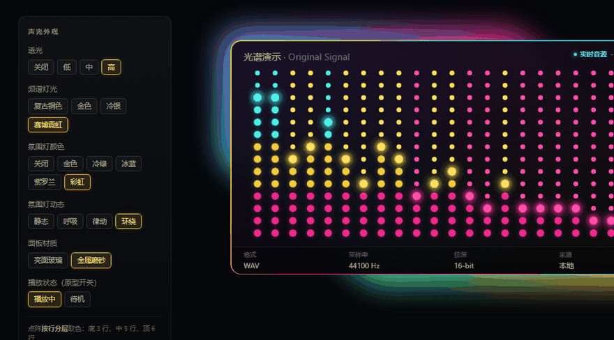
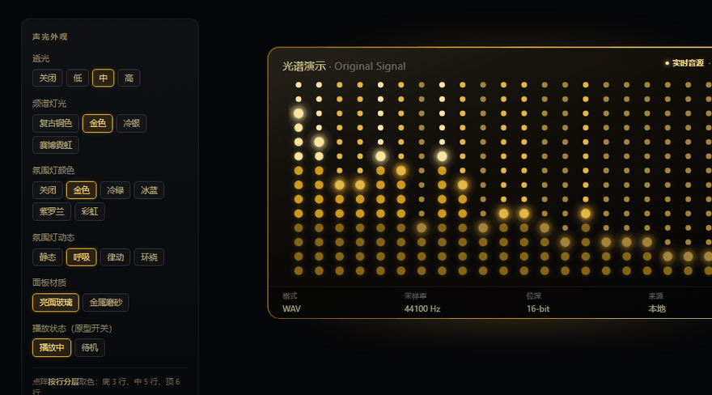

# 点阵频谱与辉光 —— 极光的声光外观

> 状态：方案 + 可运行原型，未动产品代码。
>
> 原型：[`proto-aura.html`](proto-aura.html)（单文件、0 位图、可直接双击打开，左上五组参数都能点）
>
> 
> 
>
> 关联：[`双风格-可行性分析.md`](双风格-可行性分析.md) 定"两套皮肤"的骨架，
> [`音色曲线-动效方案.md`](音色曲线-动效方案.md) 定 EQ 曲线的画法。
> **本篇定的是第三块：播放中的实时显示怎么长、怎么动。**

---

## 1. 先纠正一处定位偏差

上一轮我把"音色显示"理解成 9 段 EQ 的频响曲线，做了一份动效方案。看完三张截图，这个理解偏了：
截图里那套东西是**点阵频谱 + 边框辉光**，和 EQ 曲线不是一回事。

| | 点阵频谱（本篇） | EQ 曲线（另一份） |
|---|---|---|
| 回答什么 | 此刻正在响什么 | 参数把我改成了什么样 |
| 数据来源 | `analyser.getByteFrequencyData` 实时 | `getFrequencyResponse` 静态响应 |
| 刷新 | 每帧（播放中） | 参数变化时 |
| 位置 | 中间栏大面板 | 9 段滑块上方 |
| 没声音时 | 只剩暗网格 | 照常显示当前曲线 |

两者不冲突，各占一块，共用同一条 rAF。**如果只能先做一个，做点阵** —— 它是"声光"这个卖点的识别点，
EQ 曲线更像是给懂行的人看的附加信息。

---

## 2. 参考对象是什么性质（先说清边界）

三张图是**产品截图**，站点上没有可运行的实现。证据：

| 项 | 实际情况 |
|---|---|
| `auroraplay.html` | 25KB 静态页，只引 `site.css`（31KB）+ `site.js`（5KB） |
| `site.js` | 全文只有 i18n 切换、图库 tab、`data-skin-image` 换图，**没有一行频谱代码** |
| 界面图 | `assets/images/*.png`，2125×1225 静态位图，`alt` 写着"示例素材" |
| 仓库 | `auroraplay-releases` 是分发站，`AURORA_Player` 只有文档与截图；两处均**无 LICENSE** |

所以：**没有可参考的实现代码，也没有可以引用的素材。** 本篇所有内容是按截图反推的
设计规格，加上本项目自己写的一版实现 —— 这一点反而是好事，绕开了许可问题。

唯一可引用的是那五组**参数名与选项**，属于功能描述而非表达，可以对齐。

---

## 3. 五组设置，落到 4 个 CSS 变量

截图左侧那五行不是装饰，是产品的差异化所在。逐项拆开看它们到底影响什么：

| 设置 | 选项 | 影响的东西 | 实现归属 |
|---|---|---|---|
| 透光 | 关 / 低 / 中 / 高 | 外辉光强度 + 边框不透明度 | `--glow`、`--ring-op` |
| 频谱灯光 | 复古铜 / 金 / 冷银 / 赛博霓虹 | 点阵三段色 + 边框渐变 | JS 写 `--ring-bg` |
| 氛围灯颜色 | 关 / 金 / 冷绿 / 冰蓝 / 紫罗兰 / 彩虹 | 面板外溢光的色相 | `--aura-bg` |
| 氛围灯动态 | 静态 / 呼吸 / 律动 / 环绕 | 辉光怎么动 | `data-dyn` + JS 写 `--glow` |
| 面板材质 | 亮面玻璃 / 金属磨砂 | 面板表面质感 | `data-mat` |

这里有一条必须定死的分工，否则组合会失控：

> **"频谱灯光"管点阵和边框，"氛围灯颜色"只管面板外面那层光。**

如果两者都去染点阵，4×6=24 种组合里至少有一半会撞色；如果再乘上 6 套全局主题，
就是 144 种。分开之后，点阵永远只跟灯光走，氛围只影响外溢，两者互不干扰。

---

## 4. 三层结构

```
.panel
├─ .aura > i      外辉光：inset -15px，blur 24px，opacity = --glow
├─ .surface       面板底色 + 材质（玻璃高光 / 金属噪声）
├─ .dotbox
│   └─ canvas     点阵
├─ .ring          边框描边：padding 1.5px + mask 抠出的环
└─ .tag / .meta   顶部音源标记、底部四栏信息
```

`.panel` 本身**不能写 `overflow: hidden`**，否则外溢的辉光会被裁掉 —— 这是最容易漏的一条。

边框描边的做法（比 `border-image` 可控，比 SVG 省事）：

```css
.ring {
  position: absolute; inset: 0;
  padding: 1.5px;                       /* 环的粗细 */
  background: var(--ring-bg);
  -webkit-mask: linear-gradient(#000 0 0) content-box, linear-gradient(#000 0 0);
  -webkit-mask-composite: xor;
  mask: linear-gradient(#000 0 0) content-box, linear-gradient(#000 0 0);
  mask-composite: exclude;
}
```

两个 `linear-gradient` 叠出"只留 padding 区域"的效果，于是渐变可以顺着边框走 ——
赛博霓虹"左青右洋红"就是一条 `linear-gradient(100deg, #22E0FF, #FF2D95)`。

---

## 5. 点阵怎么画（和现有 `viz.js` 的差异）

现有频谱是 48 根圆角柱 + 一条波形线 + 峰值保持（`viz.js:196` 起）。
点阵不是"把柱子换成点"，有四处是结构性差异：

| 项 | 现状 `viz.js` | 点阵 |
|---|---|---|
| 元素 | 48 根圆角柱，宽度均分 | **22 列 × 14 行圆点**，列数固定 |
| 配色 | 竖向渐变（底暗顶亮）+ 柱顶叠横向色 | **按行分三段纯色**，同一行同一个色 |
| 未点亮部分 | 不存在（柱高就是值） | **中性灰网格，必须画** |
| 峰值 | 独立峰值线（`V.peaks`） | 顶端那颗点提亮，当"针尖" |
| 波形线 | 有 | 去掉，点阵不需要 |

**为什么必须"按行分色"而不是"按列渐变"**：截图里赛博那张，底部三行全是洋红、中间五行全是黄、
顶部全是青，**同一行横向颜色完全一致**。这是点阵与柱状图最本质的区别 ——
每个点只有一个颜色，无法做渐变，只能按高度分段。低矮的列因此永远只有洋红，
高列才能露出青色顶，这正好把"高频能量不足"这件事表达出来了。

四条硬规则，每条都是我在原型里踩过才写下的：

1. **熄灭点必须是中性灰、不透明、不用灯光色。** 我第一版用 `bands[1]` 的暗色去画熄灭点，
   结果暗点和暗的洋红点亮点在色相上撞了，整块面板看起来"全都亮着"。
2. **光晕不能每点一次 `shadowBlur`。** 308 个点逐个做高斯是逐点模糊，帧率会掉到个位数。
   改成离屏预渲染 3 张（每条色带一张）发光贴图，每帧 `drawImage`。
3. **光晕尺寸要按格高约束。** 贴图大小取 `min(dotRad*4.2, cellH*1.45)`。
   不约束的话，矮柱的光晕会盖住上方两格，柱子看起来比实际高 —— 这是"频谱显示在骗人"级别的错。
4. **顶端那颗点往白里提亮 15–20%。** 纯色顶端不够亮，加一层提亮后才有"针尖"感，
   用户的视线才会跟着最高的那根走。

频率取样直接沿用 `viz.js:215` 的对数映射，不要另写一套：

```js
const bin = Math.floor(Math.pow(t, 1.85) * freq.length * 0.62);
```

线性取样会让低频挤成一坨、高频全部贴地，22 列里前 8 列一样高。

> 原型里没有真实音频，用电平合成代替。正式实现只需把 `synthLevels()` 换成
> `an.getByteFrequencyData(freq)` + 上面的映射，**绘制部分一行都不用改**。

---

## 6. 四种动态，四套技术

这是最容易做歪的部分：四个选项看起来同类，实际成本差一个数量级。

| 动态 | 实现 | 成本 | 注意 |
|---|---|---|---|
| 静态 | 什么都不做 | 0 | —— |
| 呼吸 | CSS `@keyframes` 改 `opacity` | **零 JS** | keyframe 里可以引用 `var(--glow)`，但在跑动画时 JS 改这个变量不生效 |
| 律动 | JS 把音频能量写进 `--glow` | 每 3 帧一次 | **必须节流**。每帧写 CSS 变量会触发整层样式重算 |
| 环绕 | `transform: rotate()` 转一个放大的 `conic-gradient` 层 | 合成器 | **不要**去插值渐变角度 |

"环绕"这条要特别说：直觉做法是用 `@property` 注册 `--angle` 然后每帧改它，
但那样每帧都在重算 `conic-gradient` 的光栅化。正确做法是把渐变画在一张比面板大的层上，
然后 `transform: rotate()` —— 走合成器线程，零重绘，代价几乎为零。

"律动"的读数是面板整体 RMS，不是某一列。取 `sqrt(mean(levels²))`，
写成 `--glow = base × (0.46 + rms × 1.05)`。用平方平均而不是算术平均，
是因为算术平均会被高频那些接近 0 的列拖平，指针几乎不动。

---

## 7. 六个坑（都是实测出来的）

| # | 现象 | 原因 | 修法 |
|---|---|---|---|
| 1 | 点阵挤在面板上半部分，下面一大片空 | `canvas` 是**替换元素**，绝对定位四边 `inset` + `width: auto` **不会拉伸**，它退回固有像素尺寸 | 外面包一层 `.dotbox` 定尺寸，canvas 用 `width/height: 100%` |
| 2 | 熄灭点比点亮的点还抢眼 | 中性灰在暖色底上色温偏高，形成反差 | 熄灭点 alpha 压到 `.045`，并随材质微调 |
| 3 | 点阵像白噪声，不像频谱 | 每列用独立随机数 | 改低频正弦叠加：`0.70 + 0.29sin(1.87i) + 0.19sin(3.61i)`，相邻列相关，起伏成团块 |
| 4 | 最左侧几列等高一堵墙 | 起伏周期太长（7 列一个周期），前几列同向 | 提高起伏频率到 1.87 + 3.61 rad/列 |
| 5 | 外辉光散成一片雾，边框描边被淹没 | `inset -24px` + `blur 30px` 范围过大 | 收到 `inset -15px` + `blur 24px`，参考产品的辉光是紧贴边框的一圈 |
| 6 | 整块面板发灰 | `.surface` 底色 alpha 只有 .86，外辉光透上来 | 提到 .95 以上，只留一点点透光感 |

第 1 条是最值得记住的：它不报错、不警告，只是**静静地把画面画到错误的位置和尺寸上**，
乍看像"布局问题"，其实是 CSS 对替换元素的规则。这个坑在 `viz.js` 里没遇到，是因为
`app.css:770` 的 `.viz-wrap > canvas` 本来就用了外层容器。

第 3、4 条合起来是一条经验：**假数据的"像不像"不在数值范围，在相邻列的相关性**。
真实频谱的相邻列高度差不大但整体成团，纯随机会显得脏，周期太长又显得假。

---

## 8. 性能实测

Chromium（headless）、1180×620、DPR 1：

| 状态 | 帧率 | 最差帧 |
|---|---|---|
| 金色 / 呼吸 / 玻璃 / 中透光 | 60 fps | 16.8 ms |
| 赛博 / 彩虹 / 律动 / 金属 / 高透光 | 60 fps | 16.8 ms |

最重态没掉帧。关键在三条：光晕用贴图不用 `shadowBlur`、呼吸走 CSS、
环绕走 `transform`。这三条中任意一条做错，帧率会立刻掉到 30 以下。

律动那条循环要和现有的 `viz.js` 主循环合并，**不要新开第四条 rAF** ——
项目里已经有 3 条（`viz.js:283`、`download.js:1113`、`:1555`）。

---

## 9. 接进本项目

### 9.1 改造点

| 文件 | 改动 | 量 |
|---|---|---|
| `web_ui/viz.js` | `draw()` 的柱状部分换成点阵渲染器，保留 analyser / 循环 / 主题色 | ~120 行重写 |
| `web_ui/app.css` | `.aura` / `.ring` / `.surface` / `.dotbox` 四块 | ~80 行新增 |
| `web_ui/index.html` | 中间栏面板加三层结构 | ~10 行 |
| 新增 `tone-ui.js` | 五组参数的面板 + localStorage | ~100 行 |

### 9.2 渲染器要可替换，不能写死

点阵会**改变 deck 磁带机皮肤的外观**。两套皮肤共用一个 canvas 时，正确的做法是
把 `draw()` 抽成可替换的渲染器：

```js
VIZ.setRenderer('dots');   // 极光：点阵
VIZ.setRenderer('bars');   // deck：现有柱状 + 波形
```

这和 [`双风格-可行性分析.md`](双风格-可行性分析.md) 的 Skin 契约一致：
皮肤只能调参数和挑渲染器，不能自己拿 `ctx` 去画。

### 9.3 浅色主题怎么处理（必须定的一条）

本项目的 6 套复古主题是**浅色底**（米色/砖红），而点阵面板是深色玻璃。
正确做法不是"让面板跟着变浅"，而是：

> **这块面板永远是深色显示屏，在浅色主题里它是一块嵌进界面的深色屏幕。**

理由有两条，都硬：
- 点阵的"熄灭点"要靠深底才有对比。浅底上灰点会消失，整个点阵退化成"一串亮方块"。
- 辉光在浅底上会变成脏影，不是光。

所以面板底色固定取深色（按灯光微调暖/冷），**只有边框和外辉光的色相参与主题**。
这一点和 [`方案分析.md`](方案分析.md) §9「皮肤不跟随主题」的结论一致，属于同一条原则。

### 9.4 持久化

```js
localStorage["msu1.aura"] = { glow, light, ambient, dyn, mat }
```

和现有 `theme.js` 的存储键分开，互不影响。

---

## 10. 和 EQ 曲线的关系

两块显示共用一条 rAF，但画在不同的 canvas 上，互不干扰：

```
rAF
├─ 点阵 canvas（每帧：分析器 → 22 列电平 → 圆点）
└─ 曲线 canvas（参数变化时重算，动画时插值）
```

曲线那份方案（[`音色曲线-动效方案.md`](音色曲线-动效方案.md)）里"叠一层淡频谱"的建议，
现在可以撤掉 —— 点阵本身就把"音乐能量在哪"表达得很清楚了，再叠一层是重复。

---

## 11. 待定

1. **点阵放在哪**：中间栏大面板（截图那样，推荐）／dock 展开条（高度不够，14 行压成 8 行会难看）
2. **"频谱灯光"与全局主题的关系**：我建议**完全独立**，不跟 6 套主题联动 ——
   否则要维护 4 灯 × 6 主题的映射表，而且赛博霓虹配米色主题必然难看
3. **"氛围灯颜色"默认值**：跟随灯光色（推荐）还是固定金色
4. 面板里的"透光 / 材质"是常驻入口还是收进设置面板（截图是常驻面板，占地方不小）
